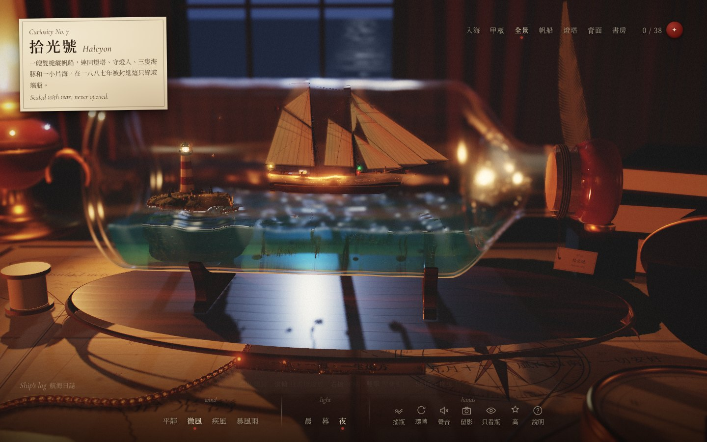
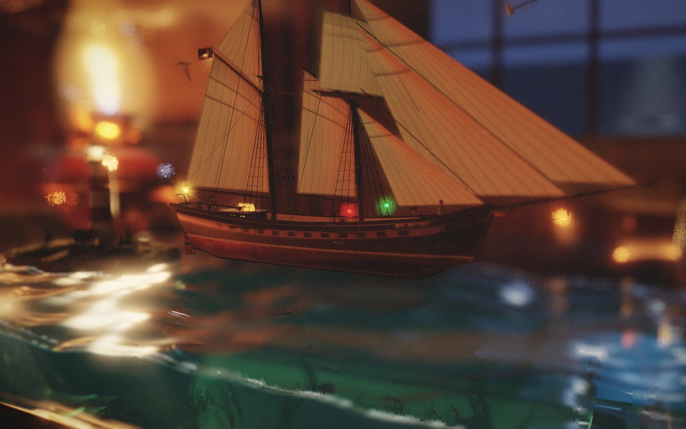
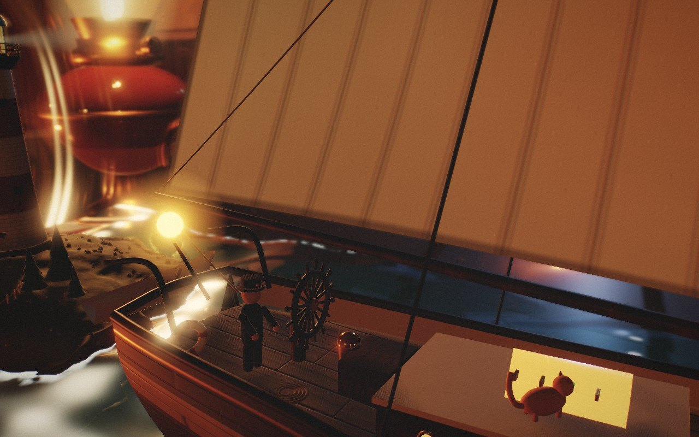
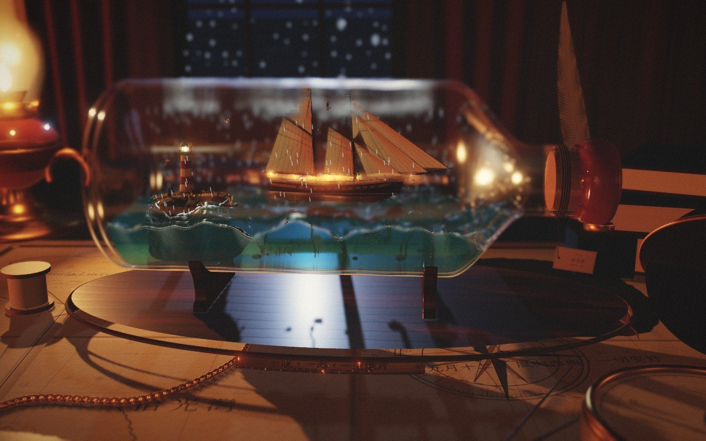
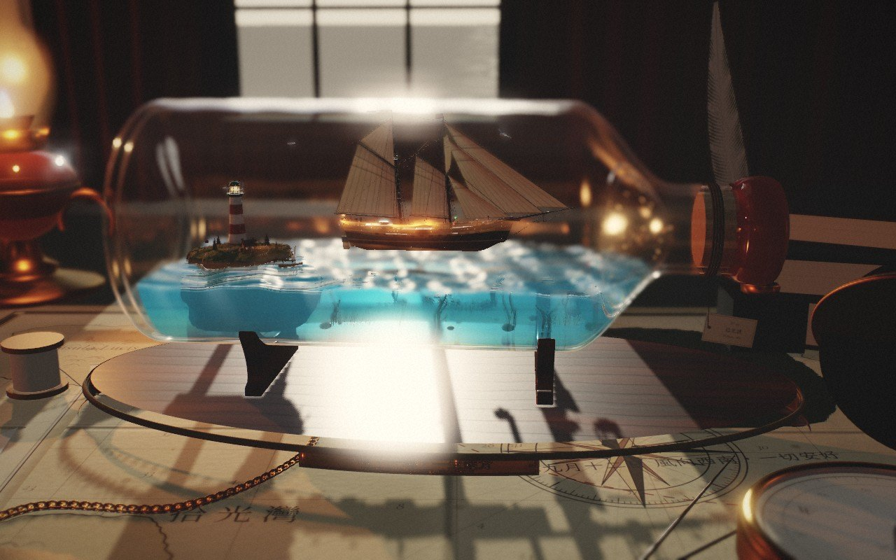
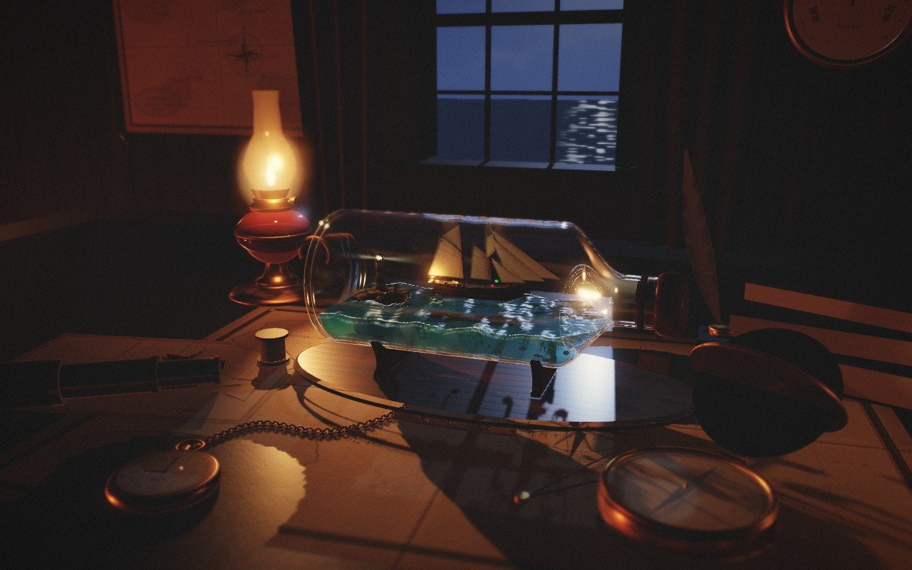

<div align="center">

# 拾光號 · 瓶中遠方

一艘封在綠玻璃瓶裡的雙桅縱帆船，連同燈塔、守燈人、三隻海豚，和一小片會晃動的海。

## [▶ 直接開啟](https://rolanthhuang.github.io/ShipInBottle/)

**https://rolanthhuang.github.io/ShipInBottle/**

[](https://rolanthhuang.github.io/ShipInBottle/)

<sub>單一 HTML 檔（約 11 MB，字型與材質都已內嵌）· 建議使用 Chrome／Edge · 第一次載入需要幾秒</sub>

</div>

---

## 怎麼玩

| 操作 | 效果 |
|---|---|
| 左鍵拖曳（手機：單指） | 360° 繞著瓶子看，背面、書房都看得到 |
| 滾輪（手機：雙指捏合） | 往游標指著的地方拉近 |
| 右鍵拖曳（手機：雙指拖曳） | 平移 |
| 雙擊 | 飛過去，對焦在那裡 |
| 點擊物件 | 互動。全場有 38 個小發現，右上角的封蠟可以查看進度 |
| Shift＋拖曳（手機：長按再拖） | 搖晃瓶子，海水跟著晃、濺起水花，船也會晃 |
| 點底座的黃銅銘牌 | 刻上你自己的字 |
| 點桌上的望遠鏡 | 拿起望遠鏡看瓶子（`Esc` 放下） |

**鍵盤**：`1`–`7` 切換視角（入海／甲板／全景／帆船／燈塔／背面／書房）· 方向鍵環繞 · `+` `-` 縮放 · `S` 搖瓶 · `R` 自動環轉 · `M` 聲音 · `P` 留影 · `H` 只看瓶 · `?` 說明 · `Esc` 關閉

**下方面板**：風（平靜／微風／疾風／暴風雨）· 光（晨／暮／夜）· 畫質（低／中／高／極致；跑不動時會自動降一級）

## 把字刻進網址裡

銘牌的文字可以直接寫在網址裡，傳給別人時他看到的就是你刻的字：

```
https://rolanthhuang.github.io/ShipInBottle/?text=一路順風&sub=BON VOYAGE · 2026
```

| 參數 | 用途 |
|---|---|
| `text`、`sub` | 銘牌主句、副句 |
| `tod` | 光線：`0` 晨、`1` 暮、`2` 夜 |
| `wind` | 風：`0` 平靜 … `3` 暴風雨 |
| `skip`＋`view` | 跳過開場，直接到某個視角：`sea` `deck` `overview` `ship` `lighthouse` `back` `study` |
| `q` | 畫質：`low` `mid` `high` `ultra` |

## 畫面

| | |
|:-:|:-:|
|  |  |
|  |  |
|  |  |

## 瓶子裡有什麼

- **拾光號**：原創的雙桅縱帆船。有船長、瞭望手、水手和一隻貓，也有舵輪、船鐘、救生艇和航行燈。帆會隨風鼓起，也會透光
- **燈塔與小島**：旋轉的燈、提著燈的守燈人、小屋、曬衣繩、碼頭和小船
- **海裡**：海豚、海鷗、魚群、海龜、水母、海草、半埋在沙裡的寶箱，還有一只更小的瓶中信
- **水**：波浪、漣漪、跟著瓶子晃動的水面、浮力、泡沫、焦散、反射與折射，夜裡會有螢光
- **玻璃**：折射與色散、刮痕、污痕、灰塵、凝結的水氣、氣泡、浮雕字
- **書房**：油燈、壁爐、燭台、地球儀、氣壓計、壁鐘、懷錶、望遠鏡、航海圖、信、航海日誌，都可以點
- **聲音**：海浪、風、雨、雷、壁爐、木頭的嘎吱聲、船鐘、霧笛、海鷗、貓（開場選「開聲音起航」，或按 `M`）

## 技術

- Three.js r186，加上自己寫的多通道渲染：玻璃與水的螢幕空間折射、螢幕空間反射、散景景深、Bloom、ACES 色調、暗角、底片顆粒
- 所有材質都由程式離線烘焙（`tools/bake.py`，numpy），以 WebP 內嵌。中文字型是子集化的思源宋體（Noto Serif CJK）和霞鶩文楷 TC
- 單一檔案、不需網路：把 `index.html` 下載下來（[Code → Download ZIP](https://github.com/RolanthHuang/ShipInBottle/archive/refs/heads/main.zip)），直接雙擊也能開
- 桌機或筆電效果最好；手機也能開，但會比較燙

## 修改與重建

```bash
npm install
npm run build        # 產生 index.html，GitHub Pages 讀的就是這個檔
```

| 路徑 | 內容 |
|---|---|
| `src/` | 場景：`main.js` 主程式與互動、`ship.js` 帆船、`water.js` 水、`glass.js` 瓶子、`island.js` 燈塔島、`creatures.js` 動物、`room.js` 與 `desk.js` 書房、`post.js` 後製、`camera.js` 視角 |
| `template.html` | 介面與文案 |
| `assets/` | 烘焙好的材質（WebP）與字型子集（WOFF2） |
| `tools/bake.py` | 重新烘焙材質（`pip install numpy pillow`，`--only deck,sail` 可只做部分） |
| `tools/fonts.py` | 重新產生字型子集（需求寫在檔案開頭） |
| `tools/shot.py`、`tools/itest.py` | 無頭瀏覽器截圖、互動測試（Playwright，不需要顯示卡） |

## 連結出現 404？

GitHub Pages 需要先開啟一次。到這個 repo 的 **Settings → Pages → Build and deployment**，Source 選 **Deploy from a branch**，Branch 選 **main**、資料夾選 **/ (root)**，按 **Save**。等一兩分鐘，上面的連結就能用了。

## 授權

本專案用到 three.js（MIT）、Noto Serif CJK、LXGW WenKai TC 和 Cormorant Garamond（SIL OFL 1.1），詳見 [THIRD_PARTY_NOTICES.md](THIRD_PARTY_NOTICES.md)。
